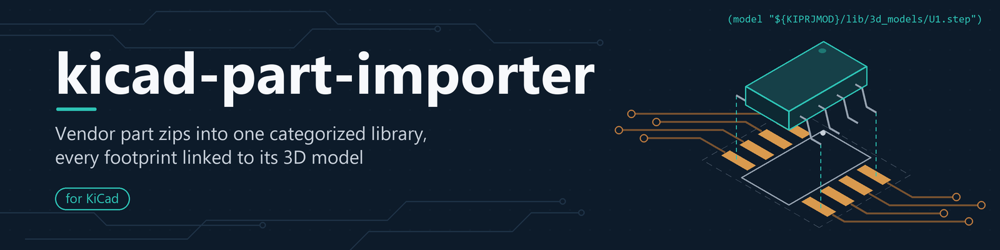
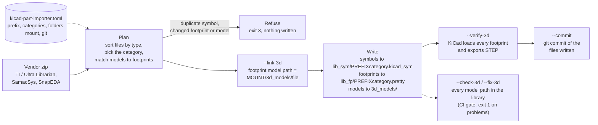

<p align="center">
  
</p>

# kicad-part-importer

**Import vendor part downloads (TI / Ultra Librarian, SamacSys, SnapEDA) into one categorized KiCad library, with every footprint linked to its 3D model.**

[](LICENSE)
[](pyproject.toml)
[](https://github.com/aqsnyder/kicad-part-importer/actions/workflows/tests.yml)
[](https://www.kicad.org/)

## Why

Every part download from a vendor or CAD-model site holds a symbol, a
footprint or three, a STEP model, and files for other CAD tools. Dropped
into a KiCad library as they are, most of those footprints show **no 3D
body**:

- TI / Ultra Librarian and SnapEDA footprints have no `(model ...)` line at
  all;
- SamacSys footprints name the model by a bare file name, which KiCad looks
  for next to the project file;
- older libraries carry absolute paths from somebody's machine, or names in
  the wrong letter case that load on Windows and fail on Linux.

You find out when the STEP export for the enclosure comes back with holes in
it. kicad-part-importer files each part into the right category library,
points every footprint at the library's copy of its model through a path
that works in every project, and can prove in KiCad that each model loads.

It is a standalone tool, separate from any part library. It works on the
library you point it at, and each library describes itself in its own
`kicad-part-importer.toml`, so a company can use the public tool with a
private library and private naming conventions.

## Features

- **One command per part**: symbols, footprints and 3D models from a vendor
  zip go into the category you choose (`--category power_management`, a
  library name or a menu number).
- **Plans before it writes**: a planned import reads the zip and the library
  first and **refuses, before writing anything**, a symbol that already
  exists or a footprint / model that exists with other content
  (`--overwrite` to replace). `--dry-run` shows the plan.
- **3D models that load everywhere**: `--link-3d` rewrites or inserts each
  footprint's `(model ...)` as `${KIPRJMOD}/<library>/3d_models/<file>` (or
  through your own `${VAR}`), keeping offset, scale and rotation.
- **Library check for CI**: `--check-3d` classifies every model path in the
  library (ok, case, missing, bare, absolute, other-var, stock) and exits 1
  on problems; `--fix-3d` rewrites the fixable ones and removes dead
  duplicate references.
- **Proof in KiCad**: `--verify-3d` loads the footprints with KiCad's own
  `pcbnew` and `kicad-cli`, exports STEP, and reports every model that does
  not load. It also works on a `--dry-run`.
- **Self-describing libraries**: `--init` creates a library (or describes an
  existing one) and writes its config file. The tool finds that file by
  walking up from the current directory, the way git finds `.git`.
- **Your conventions**: name prefix, categories and descriptions, folder
  names, mount, extra model search folders and git commit / push behaviour
  are all settings.
- **Project integration and migration**: `--add-to-project` adds the
  category libraries to a project's `sym-lib-table` / `fp-lib-table`.
  `--migrate` and `--migrate-schematic` move parts in from older libraries
  and schematics.
- **Built for scripts and agents**: `--json` prints one report on stdout,
  with exit codes 0 ok, 1 failed, 2 usage, 3 refused. Standard library only
  (plus `tomli` on Python < 3.11). Runs on Linux, macOS and Windows (CI
  tests Linux and Windows).

## How it works



## Install

```bash
pip install git+https://github.com/aqsnyder/kicad-part-importer
```

A fixed release, which is what a team should pin:

```bash
pip install "git+https://github.com/aqsnyder/kicad-part-importer@v0.1.0"
```

From a checkout:

```bash
git clone https://github.com/aqsnyder/kicad-part-importer
cd kicad-part-importer
pip install .            # or: pip install -e ".[test]" for development
```

`pipx install git+https://github.com/aqsnyder/kicad-part-importer` keeps the
tool in its own environment. Without installing, run
`python kicad_part_importer.py` from the checkout; the four
`kicad_*.py` modules must stay together.

## Requirements

- **Python 3.9 or newer.** No other packages on Python 3.11+. On 3.9 and 3.10
  the install pulls in `tomli` to read TOML config files (JSON config files
  need nothing).
- **KiCad: only for `--verify-3d`.** Tested with KiCad 10.0.7; a KiCad 9
  install is found too but is untested. `--verify-3d` needs `kicad-cli` and a
  Python that imports `pcbnew`. The Windows install has both and is found by
  itself. On Linux and macOS see [docs/3d-models.md](docs/3d-models.md#requirements-and-how-kicad-is-found).
  Everything else works without KiCad.
- **git: only for `--commit` / `--push`** (or the `git_commit` / `git_push`
  settings), with the library in a git repository.

## Quick start

```bash
cd ~/kicad/my_board
mkdir my_kicad_library && cd my_kicad_library
kicad-part-importer --init                       # config file + folders + empty category libraries

# See what an import would do, without writing anything
kicad-part-importer ~/Downloads/LIB_DEMOTVS5.zip --category protection --link-3d --dry-run

# Import it, link the footprint to its model, and prove the model loads in KiCad
kicad-part-importer ~/Downloads/LIB_DEMOTVS5.zip --category protection --link-3d --verify-3d --yes

# Check every footprint's 3D model path in the library
kicad-part-importer --check-3d

# Add category libraries to the project's sym-lib-table / fp-lib-table
kicad-part-importer --add-to-project
```

What a planned import prints (real output from
[docs/getting-started.md](docs/getting-started.md)):

```text
$ kicad-part-importer ~/Downloads/LIB_DEMOTVS5.zip --category protection --link-3d --dry-run
Plan: LIB_DEMOTVS5.zip -> protection (lib_protection)
  symbol     DEMOTVS5               append    lib_sym/lib_protection.kicad_sym
  footprint  SOD_DEMO               add       lib_fp/lib_protection.pretty/SOD_DEMO.kicad_mod
             model: rewrite DEMOTVS5.stp -> ${KIPRJMOD}/my_kicad_library/3d_models/DEMOTVS5.stp (named by footprint)
  3D model   DEMOTVS5.stp           add       3d_models/DEMOTVS5.stp
  ignored    DEMOTVS5/Altium/DEMOTVS5.SchLib, DEMOTVS5/KiCad/DEMOTVS5.lib, license.txt
⚠ symbol DEMOTVS5: Footprint field 'SOD_DEMO' has no library prefix (KiCad needs lib_protection:SOD_DEMO)
Dry run: nothing written.
```

## Usage examples

```bash
# Interactive: category menu, then "delete the zip?"
kicad-part-importer part.zip

# No prompts, machine-readable report, for scripts and agents
kicad-part-importer part.zip --category 5 --link-3d --dry-run --json

# Import and commit exactly the files written
kicad-part-importer part.zip --category power_management --link-3d --yes --commit

# Fix the model paths of a whole library, then prove they load in KiCad
kicad-part-importer --check-3d --fix-3d --dry-run
kicad-part-importer --check-3d --fix-3d --verify-3d --yes

# Describe an existing library that uses its own prefix and model folder
kicad-part-importer --init --library-prefix acme_ --model-dir models \
    --library-mount '${KIPRJMOD}/acme_kicad_library'

# Work on a library from outside it
kicad-part-importer --library ~/kicad/my_board/my_kicad_library --check-3d

# Move the custom parts a schematic uses into the categories
kicad-part-importer --migrate-schematic ../power.kicad_sch

# Show the effective settings and where they came from
kicad-part-importer --show-config
```

## Documentation

| Page | Contents |
|---|---|
| [docs/index.md](docs/index.md) | Overview and map of the documentation |
| [docs/getting-started.md](docs/getting-started.md) | Install, create a library, first import, add to a KiCad project |
| [docs/cli.md](docs/cli.md) | Every option with its default and environment variable, exit codes, the JSON report |
| [docs/configuration.md](docs/configuration.md) | Library discovery, the config file, every setting (type, default, example) |
| [docs/vendor-formats.md](docs/vendor-formats.md) | TI / Ultra Librarian, SamacSys and SnapEDA zip layouts and what is taken from each |
| [docs/3d-models.md](docs/3d-models.md) | `--link-3d`, `--check-3d`, `--fix-3d`, `--verify-3d` with before/after output |
| [docs/kicad-integration.md](docs/kicad-integration.md) | Library tables, `${KIPRJMOD}` and `${VAR}` mounts, submodules |
| [docs/private-library.md](docs/private-library.md) | A company workflow: private library repo, pinned tool, CI check, migrating an `acme_` library |
| [docs/troubleshooting.md](docs/troubleshooting.md) | Every error message and what to do, FAQ |

## Configuration

The library root is `--library DIR`, else `KICAD_PART_IMPORTER_LIBRARY_ROOT`,
else the nearest folder at or above the current directory that holds a
`kicad-part-importer.toml` / `.json`, else the current directory. Settings
come from flags, then `KICAD_PART_IMPORTER_*` environment variables, then
that config file, then the defaults. `--show-config` prints the result.

| Setting | Default | Meaning |
|---|---|---|
| `library_prefix` | `lib_` | Category libraries are `<prefix><key>` |
| `symbol_dir` / `footprint_dir` / `model_dir` | `lib_sym` / `lib_fp` / `3d_models` | Folders in the library root |
| `model_search_dirs` | `[]` | More folders `--fix-3d` searches for models |
| `project_dir` | folder holding the library | Where `--add-to-project` finds the project tables |
| `library_mount` | `${KIPRJMOD}/<library folder>` | How projects reach the library, in model paths and table entries |
| `model_prefix` | `<library_mount>/<model_dir>` | The path `--link-3d` writes |
| `categories` | 13 general electronics categories | Keys, descriptions, library names, menu order |
| `stock_symbol_libraries` | KiCad's common libraries | Left alone by `--migrate-schematic` |
| `git_commit` / `git_push` / `git_message_prefix` | `false` / `false` / `""` | Commit / push after every write, message prefix |

A library in its own house style (`kicad-part-importer.toml` in the library
root, trimmed):

```toml
library_prefix = "acme_"
model_dir = "models"
model_search_dirs = ["vendor/SamacSys_Parts.3dshapes"]
library_mount = "${KIPRJMOD}/acme_kicad_library"
git_commit = true
git_message_prefix = "parts: "

[[categories]]
key = "power"
description = "Power management"
```

Every setting, with examples: [docs/configuration.md](docs/configuration.md).
Every flag and environment variable: [docs/cli.md](docs/cli.md).

## Git

`--commit` commits after the work. A planned import commits exactly the files
it wrote; the other commands that write (`--init`, `--init-libraries`,
`--migrate`, `--migrate-schematic`, `--add-to-project`, the interactive
import) stage everything under the library root (`git add .`). `--push` runs
`git push` afterwards. The library's config file can turn both on
(`git_commit`, `git_push`) and set a commit-message prefix.
`--no-commit` / `--no-push` turn them off for one run.

The tool never runs `git push` unless `--push` or `git_push = true` asks for
it. A `--dry-run` never commits or pushes, and neither does a refused
import. **`--commit` and `--push` do not apply to `--check-3d`**: it never
commits or pushes, even with `--fix-3d`, so review and commit its fixes
yourself.

## Limitations and known issues

- The **interactive import** (a zip with none of the planned-run options)
  copies files as they are. It does not link models, overwrites a footprint
  or model of the same name, appends a symbol even if one of that name
  exists, and treats `.stl`, `.3d` and any file with `3d` in its name as a
  model. The planned run refuses conflicts and takes only model file
  extensions.
- `--add-to-project`, `--migrate` and `--migrate-schematic` always ask
  questions, so they cannot run with `--yes` / `--dry-run` / `--json`.
- **Symbol Footprint fields are not rewritten.** The plan warns when a
  vendor's field does not name the category library; set it in KiCad's
  Symbol Editor.
- Symbols are appended to the library as text. A new or empty symbol library
  is written with a KiCad 6 header; KiCad reads it and upgrades the format the
  next time it saves the library.
- The library-table and schematic edits are text edits that expect KiCad's
  usual formatting (one `(lib ...)` entry per line; tab-indented schematics
  and symbol libraries for the migration commands).
- `--check-3d` recognizes a library model path by the library mount. A
  `model_prefix` outside `<library_mount>/` is written by `--link-3d` as
  given, but `--check-3d` reports those paths as `other-var` (or `absolute`).
- `--verify-3d` needs `kicad-cli` and a Python that imports `pcbnew`. Default
  install folders are probed on Windows only. kicad-cli exits 0 when models
  are missing, so the result is read from its messages; a future KiCad that
  rewords them could hide failures.
- The tool does not rename categories' libraries, and does not download
  parts: it works on zips you downloaded under each vendor's own terms.
- Not yet on PyPI; install from GitHub as above.

## Contributing

Issues and pull requests are welcome; see [CONTRIBUTING.md](CONTRIBUTING.md)
for the development setup, the test suite (which runs with or without KiCad)
and the style. Changes are listed in [CHANGELOG.md](CHANGELOG.md).

## License

MIT; see [LICENSE](LICENSE).

Third-party notes: on Python 3.9 and 3.10 the tool uses
[tomli](https://github.com/hukkin/tomli) (MIT) to read TOML. `--verify-3d`
runs [KiCad](https://www.kicad.org/) (GPL-3.0-or-later) as an external
program; no KiCad code is included. KiCad, Texas Instruments, Ultra
Librarian, SamacSys / Component Search Engine and SnapEDA are names and
trademarks of their owners. This project is not affiliated with or endorsed
by any of them. The example parts in the documentation are synthetic.
